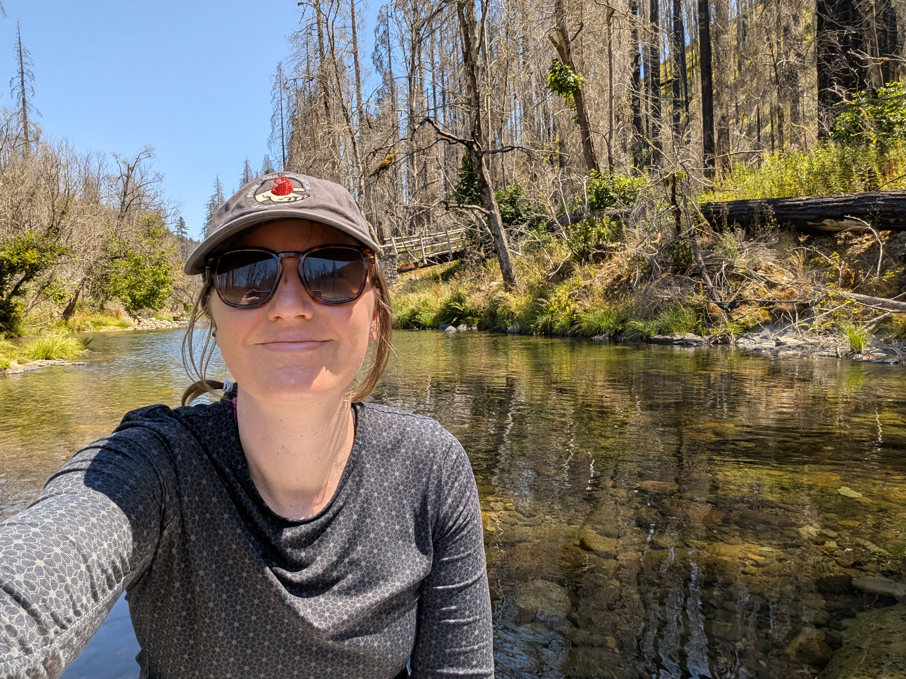

{fig-alt="photo of Katie Wampler" fig-align="center" width="526"}

Hi, I'm **Katie**! I'm a researcher, data manager, and software developer working at the intersection of watershed science, environmental data, and wildfire. I'm interested in understanding how disturbances like wildfire affect water quality and what those changes mean for the people who depend on healthy watersheds and reliable drinking water.

 

------------------------------------------------------------------------

 

My interest in wildfire and water quality started after [reading](https://www.opb.org/news/series/wildfires/eagle-creek-fire-oregon-portland-drinking-water-bull-run/) about the 2017 Eagle Creek wildfire in the Columbia River Gorge that threatened Portland, Oregon's water supply. The article mentioned increased sediment in the water, but it got me wondering: what other impacts might the fire have? That question helped shape my research. I earned my Ph.D. in Water Resources Science from Oregon State University in 2025, studying how wildfire influences carbon and nutrient transport in streams. My work combins field data and advanced statistical and geospatial approaches to understand why watersheds respond differently to wildfire and how we can better anticipate impacts on water resources.

I'm currently a research analyst and data manager for the [Wildfire and Water Security](https://wws.forestry.oregonstate.edu/) project. My work currently spans research, data management, software development, and science communication. I use R to wrangle, analyze, and visualize environmental data, build reproducible workflows, and develop open-source tools that make research data easier to work with. I also spend time designing informal materials to share our science with a broader audience. I particularly enjoy finding practical solutions to messy data problems, automating repetitive tasks, and building tools that help researchers spend less time fighting with their data and more time figuring out what it means.

When I'm not debugging code, moonlighting as a graphic designer, or digging through datasets, I enjoy baking (the more complicated the better), photography, and playing strategy games.
